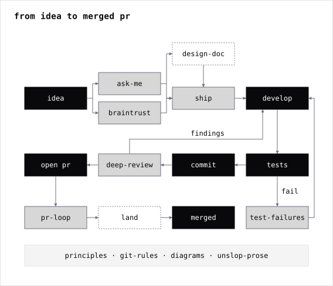

# stevestack

Steve's workflow for shipping code: brainstorming, model panels, design docs,
working principles, deep review, PR shepherding, diagrams, and Git and test
hygiene.

See the [main installation guide](../../README.md#installation) for Claude
Code, Codex, and standalone Agent Skills setup.

## Skills

<!-- BEGIN GENERATED SKILLS -->
- [`ask-me`](skills/ask-me/SKILL.md) — Brainstorm an unsettled idea together, one question at a time.
- [`braintrust`](skills/braintrust/SKILL.md) — Convene a mini or mega panel of different models on a design, codebase or decision, and lead with the findings only one panelist raised. Use when the user asks for a braintrust, panel, council, mini-panel or mega-panel, or wants several independent opinions.
- [`deep-review`](skills/deep-review/SKILL.md) — Use when a deeper level of code review is requested. Multi-agent panel code review with specialist reviewers and forced runtime reproducers for all BLOCKING bug findings. Optionally posts to GitHub/GitLab as a PENDING review.
- [`design-doc`](skills/design-doc/SKILL.md) — Write a short, accurate design doc in Google Docs with diagrams. Use when asked to write or update a design doc.
- [`diagrams`](skills/diagrams/SKILL.md) — Draw minimal monospace box diagrams (architecture, trust boundaries, data flow, sequence of steps) for a design doc, RFC, README or slide, rendered to a light-and-dark SVG plus PNGs from hand-placed coordinates with the bundled Python script. Use whenever a document needs a diagram and the ask is for a clean, high-level picture rather than an auto-laid-out graph.
- [`git-rules`](skills/git-rules/SKILL.md) — Use this skill for critical Git rules whenever working with Git, especially before committing, pushing, rebasing, comparing branches, or preparing a pull request.
- [`land`](skills/land/SKILL.md) — Authorize merging the current PR yourself once it meets the bar.
- [`pr-loop`](skills/pr-loop/SKILL.md) — Shepherd a PR: merge base branch, fix CI, address review comments, resolve threads, and monitor until merged. Use when asked to drive a pull request through to merge.
- [`principles`](skills/principles/SKILL.md) — stbenjam's working principles. Use before making, reviewing, or shipping a change.
- [`ship`](skills/ship/SKILL.md) — Take work from any stage to an open, deep-reviewed PR.
- [`test-failures`](skills/test-failures/SKILL.md) — Use this skill whenever any test fails. Follow the required investigation process before deciding whether a failure is pre-existing or what to fix.
- [`unslop-prose`](skills/unslop-prose/SKILL.md) — Spawn a T3 thread on Gemini 4 Neon to review and polish all prose added on this branch for clarity, warmth, and readability. Use when asked to polish, humanize, or improve writing on a branch before shipping.
<!-- END GENERATED SKILLS -->

## How the skills fit together

`ask-me` brainstorms an idea before there is a plan, and `braintrust`
convenes a panel of models for independent opinions on a design or decision.
`design-doc` writes the design up in Google Docs when it needs one.
`ship` takes work from any stage to an open PR. It runs `deep-review` before
opening the PR, uses `diagrams` where the description needs a picture, and
hands the PR to `pr-loop` to shepherd it to merge. `unslop-prose` sends a
branch's added prose to Gemini 4 Neon to polish for clarity, warmth, and
readability. `land` authorizes the agent to merge the PR itself once it meets
the bar. `principles`, `git-rules` and `test-failures` apply throughout.

`ask-me` is adapted from the `grilling` skill in
[mattpocock/skills](https://github.com/mattpocock/skills/tree/main/skills/productivity).
